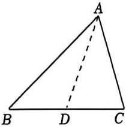
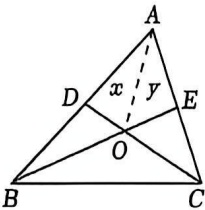
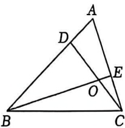

如图，已知 $\triangle ABC$的面积是 60，请完成下列问题：

（1）如图1，$\triangle ABC$ 中，若$AD$ 是$BC$ 边上的中线，则 $\triangle ABD$ 的面积 ___ $\triangle ACD$ 的面积（填">"、"<"或"="）；

（2）如图2，若CD、BE分别是 $\triangle ABC$ 的AB、$\angle C$ 边上的中线，求四边形 $ADOE$ 的面积可以用如下方法：

连接AO，由 AD=DB 得 $S_{\Delta ADO}=S_{\Delta BDO}$，

同理，可得 $S_{\Delta CEO} = S_{\Delta AEO}$

设 $S_{\Delta ADO} = x$， $S_{\Delta AEO} = y$，则 $S_{\Delta RDO} = x$， $S_{\Delta CEO} = y$。

由题意得 $S_{\triangle ABE} = \frac{1}{2}S_{\triangle ABC} = 30$，$S_{\triangle ADC} = \frac{1}{2}S_{\triangle ABC} = 30$。

可列方程组 $\begin{cases}2x+y=30\\x+2y=30\end{cases}$，解得 ___ ，

通过解这个方程组可得四边形 $ADOE$ 的面积为 ___ ；

（3）如图3，$AD:DB=1:3$，$CE:AE=2:3$，请直接写出四边形 $ADOE$ 的面积 ___ 。（不用书写过程）

图1 

图2 

图3 

> [!question]- 点击查看答案与解析
> 【答案】(1) =；(2) $x = 10$，$y = 10$，$S_{ADOE} = 20$；(3) $\frac{207}{17}$
> 【考点】[[【初中数学知识点体系-人教版】#13-2 与三角形有关的线段]]
> 【解析】
> (1) $\because AD$ 是 $BC$ 边上的中线，
> $\therefore BD = CD$，$\triangle ABD$ 与 $\triangle ACD$ 等底同高。
> $\therefore S_{\triangle ABD} = S_{\triangle ACD}$（填"="）。
>
> (2) 由题意，$CD$、$BE$ 分别是 $\triangle ABC$ 的 $AB$、$AC$ 边上的中线。
> $\because AD = DB$，$\therefore S_{\triangle ADO} = S_{\triangle BDO} = x$。
> $\because AE = EC$，$\therefore S_{\triangle AEO} = S_{\triangle CEO} = y$。
> $S_{\triangle ABE} = 2x + y = 30$，$S_{\triangle ADC} = x + 2y = 30$。
> 解得 $x = 10$，$y = 10$。
> $S_{ADOE} = x + y = 20$。
>
> (3) $AD:DB = 1:3$，$CE:AE = 2:3$。
> 设 $S_{\triangle ADO} = x$，$S_{\triangle AEO} = y$。
> $\because AD:DB = 1:3$，$\therefore S_{\triangle BDO} = 3x$。
> $\because CE:AE = 2:3$，$\therefore S_{\triangle CEO} = \frac{2}{3}y$。
> $S_{\triangle ABE} = 4x + y = 36$（$S_{\triangle ABE} = \frac{3}{5}S_{\triangle ABC} = 36$）。
> $S_{\triangle ADC} = x + \frac{5}{3}y = 15$（$S_{\triangle ADC} = \frac{1}{4}S_{\triangle ABC} = 15$）。
> 解方程组得 $x = \frac{135}{17}$，$y = \frac{72}{17}$。
> $S_{ADOE} = x + y = \frac{207}{17}$。
>
> 【易错点】注意 $AD:DB = 1:3$ 表示 $D$ 不是中点，$CE:AE = 2:3$ 表示 $E$ 也不是中点，需正确计算面积比。
