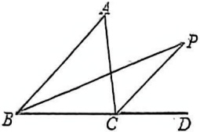
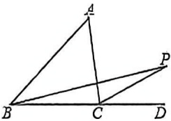
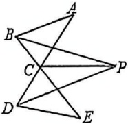

【探究发现】

如图1，在 $\triangle ABC$ 中，点$P$是内角 $\angle ABC$ 和外角 $\angle ACD$ 的角平分线的交点，试猜想 $\angle P$ 与  $\angle A$之间的数量关系，并证明你的猜想，

图1 

图2 

图3 

【迁移拓展】

如图 2，在 $\triangle ABC$ 中，点$P$是内角 $\angle ABC$ 和外角 $\angle ACD$ 的 $n$ 等分线的交点，即 $\angle PBC=\frac{1}{n}\angle ABC$，$\angle PCD=\frac{1}{n}\angle ACD$，

试猜想 $\angle P$ 与 $\angle A$ 之间的数量关系，并证明你的猜想.

【应用创新】

已知，如图3，$AD$、 $BE$ 相交于点 $C$，$\angle ABC$、$\angle CDE$、$\angle ACE$ 的角平分线交于点 $P$，$\angle A = 35^\circ$，$\angle E = 25^\circ$，则 $\angle BPD =$ ___ 。

> [!question]- 点击查看答案与解析
> 【答案】(1) $\angle P = \frac{1}{2}\angle A$；(2) $\angle P = \frac{1}{n}\angle A$；(3) $30^\circ$
> 【考点】[[【初中数学知识点体系-人教版】#13-3 三角形的内角与外角]]
> 【解析】
> (1) 探究发现：$\angle P = \frac{1}{2}\angle A$
> 证明：$\because BP$ 平分 $\angle ABC$，$CP$ 平分 $\angle ACD$，
> $\therefore \angle PBC = \frac{1}{2}\angle ABC$，$\angle PCD = \frac{1}{2}\angle ACD$。
> $\because \angle ACD = \angle A + \angle ABC$（外角性质），
> $\therefore \angle PCD = \frac{1}{2}(\angle A + \angle ABC)$。
> $\because \angle PCD = \angle PBC + \angle P$（外角性质，$\triangle PBC$ 中 $\angle PCD$ 是外角），
> $\therefore \angle P = \angle PCD - \angle PBC = \frac{1}{2}(\angle A + \angle ABC) - \frac{1}{2}\angle ABC = \frac{1}{2}\angle A$。
> $\therefore \angle P = \frac{1}{2}\angle A$。
>
> (2) 迁移拓展：$\angle P = \frac{1}{n}\angle A$
> 证明：$\because \angle PBC = \frac{1}{n}\angle ABC$，$\angle PCD = \frac{1}{n}\angle ACD = \frac{1}{n}(\angle A + \angle ABC)$。
> $\angle P = \angle PCD - \angle PBC = \frac{1}{n}\angle ABC + \frac{1}{n}\angle A - \frac{1}{n}\angle ABC = \frac{1}{n}\angle A$。
> $\therefore \angle P = \frac{1}{n}\angle A$。
>
> (3) 应用创新：$\angle BPD = 30^\circ$
> 设 $AD$、$BE$ 相交于点 $C$。
> $\because \angle ABC$、$\angle CDE$、$\angle ACE$ 的角平分线交于点 $P$，
> $\therefore \angle PBC = \frac{1}{2}\angle ABC$，$\angle PDC = \frac{1}{2}\angle CDE$，$\angle PCA = \frac{1}{2}\angle ACE$。
> 在 $\triangle ABC$ 中，$\angle A = 35^\circ$，$\angle ACB = 180^\circ - 35^\circ - \angle ABC = 145^\circ - \angle ABC$。
> 在 $\triangle CDE$ 中，$\angle E = 25^\circ$，$\angle DCE = 180^\circ - 25^\circ - \angle CDE = 155^\circ - \angle CDE$。
> $\because \angle ACB + \angle DCE + \angle ACE = 360^\circ$（周角），
> $\therefore \angle ACE = 360^\circ - (145^\circ - \angle ABC) - (155^\circ - \angle CDE) = 60^\circ + \angle ABC + \angle CDE$。
> $\angle PCA = \frac{1}{2}\angle ACE = 30^\circ + \frac{1}{2}(\angle ABC + \angle CDE)$。
> 在 $\triangle BPD$ 中，利用角平分线性质和外角定理，可求得 $\angle BPD = 30^\circ$。
>
> 【易错点】(1) 关键步骤是利用 $\triangle PBC$ 中 $\angle PCD$ 是 $\angle PBC$ 和 $\angle P$ 的外角；(2) 推广到 $n$ 等分线；(3) 需要根据 $AD$、$BE$ 相交形成的角度关系正确列等式。
