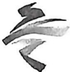
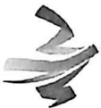

北京 2022 年冬奥会会徽是以汉字 "冬" 为灵感来源设计的。在下面右侧的四个图中，能由图 1 经过平移得到的是（）

图1 

A.

B.

C.

D.

> [!question]- 点击查看答案与解析
> 【答案】B
> 
> 【考点】平移的性质 → [[【初中数学知识点体系-人教版】#7-4 平移]]
> 
> 【解析】
> - 平移不改变图形的形状、大小和方向
> - 选项A：图形方向发生改变，不是平移
> - 选项B：图形形状、大小、方向均与原图一致，是平移得到，正确
> - 选项C：图形方向发生改变，不是平移
> - 选项D：图形方向发生改变，不是平移
> 
> 【易错点】平移与旋转的区别：平移不改变方向，旋转会改变方向。
