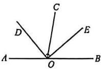

如图，$O$ 为直线 $AB$ 上一点，$OE$ 平分 $\angle BOC$，$OD \perp OE$ 于点 $O$，若 $\angle BOC=80^{\circ}$，则 $\angle AOD$ 的度数是（）

A. $70^{\circ}$

B. $50^{\circ}$

C. $40^{\circ}$

D. $35^{\circ}$

> [!question]- 点击查看答案与解析
> 【答案】B
> 
> 【考点】角平分线、垂线的定义，角的计算 → [[【初中数学知识点体系-人教版】#7-1 相交线]]
> 
> 【解析】
> - ∵ $O$ 在直线 $AB$ 上，∴ $\angle AOB=180^{\circ}$
> - ∵ $\angle BOC=80^{\circ}$，∴ $\angle AOC=180^{\circ}-80^{\circ}=100^{\circ}$
> - ∵ $OE$ 平分 $\angle BOC$，∴ $\angle BOE=\angle COE=40^{\circ}$
> - ∵ $OD\perp OE$，∴ $\angle DOE=90^{\circ}$
> - 由图可知，$D$ 在 $OC$ 与 $OA$ 之间（$OD$ 在 $OE$ 的逆时针方向）
> - $\angle AOD=\angle DOE-\angle AOE=90^{\circ}-(180^{\circ}-40^{\circ})$... 
> - 换一种方式：$\angle AOD=\angle AOC-\angle DOC$
> - $\angle DOC=\angle DOE-\angle COE=90^{\circ}-40^{\circ}=50^{\circ}$
> - ∴ $\angle AOD=100^{\circ}-50^{\circ}=50^{\circ}$
> 
> 【易错点】需要根据图形判断 $D$ 的位置关系，利用角的加减进行计算。
