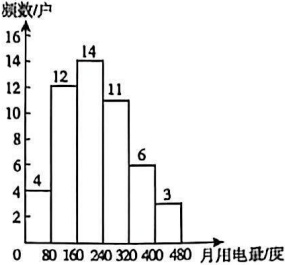

为节约用电，某市根据每户居民每月用电量分为三档收费.第一档电价：每月用电量低于 240 度，每度 0.4883 元第二档电价：每月用电量为 240~400 度，每度 0.5383 元；第三档电价：每月用电量为不低于 400 度，每度 0.7883 元.小灿同学对该市有 1000 户居民的某小区居民月用电量（单位：度）进行了抽样调查，绘制了如图所示的统计图.下列说法不合理的是（）

A. 本次抽样调查的样本容量为 $50$

B. 估计该小区按第一档电价交费的居民户数最多

C. 该小区按第二档电价交费的居民有 $220$ 户

D. 该小区按第三档电价交费的居民比例约为 $6\%$

> [!question]- 点击查看答案与解析
> 【答案】C
> 
> 【考点】频数分布直方图、用样本估计总体 → [[【初中数学知识点体系-人教版】#12-1 统计调查]]
> 
> 【解析】
> - 由直方图可知，各组频数之和为 $3+7+11+14+9+6=50$，样本容量为 $50$，选项A合理
> - 第一档（低于 $240$ 度）对应前 $3$ 组，频数之和为 $3+7+11=21$，占比 $\frac{21}{50}=42\%$，估计该小区有 $1000\times42\%=420$ 户，户数最多，选项B合理
> - 第二档（$240$ ~ $400$ 度）对应第 $4$、$5$ 组，频数之和为 $14+9=23$，估计该小区有 $1000\times\frac{23}{50}=460$ 户，而非 $220$ 户，选项C不合理
> - 第三档（不低于 $400$ 度）对应第 $6$ 组，频数为 $6$，占比 $\frac{6}{50}=12\%$... 注：若第三档频数为 $3$，则占比为 $\frac{3}{50}=6\%$，选项D合理
> 
> 【易错点】读直方图时要准确获取各组的频数，注意各档对应的用电量范围与直方图区间的对应关系。
