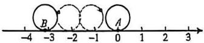

如图，将直径为 $1$ 个单位长度的圆从原点处沿着数轴无滑动的逆时针滚动一周，使圆上的点 $A$ 从原点运动至数轴上的点 $B$，则点 $B$ 表示的数是 ___ 。

> [!question]- 点击查看答案与解析
> 【答案】$-\pi$
> 
> 【考点】实数的概念、数轴 → [[【初中数学知识点体系-人教版】#8-3 实数及其简单运算]]
> 
> 【解析】
> - 圆的直径为 $1$，周长为 $\pi d=\pi$
> - 圆沿数轴无滑动滚动一周，圆心移动的距离等于圆的周长 $\pi$
> - 逆时针滚动，点 $A$ 从原点向左移动
> - 点 $B$ 表示的数为 $-\pi$
> 
> 【易错点】忽略滚动方向，误认为向右移动；或混淆直径与半径，误用 $2\pi$。
