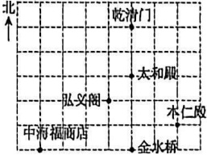

为了培养学生社会主义核心价值观，朝阳区中小学生一直坚持参观天安门广场的升旗仪式。如图是利用平面直角坐标系画出的天安门附近的部分建筑分布图，若这个坐标系分别以正东、正北方向为 $x$ 轴、$y$ 轴的正方向，表示命水桥的点的坐标为 $(1,-2)$，表示本仁殿的点的坐标为 $(3,-1)$，则表示乾清门的点的坐标是 ___ 。

> [!question]- 点击查看答案与解析
> 【答案】$(1,2)$
> 
> 【考点】用坐标表示地理位置 → [[【初中数学知识点体系-人教版】#9-1 用坐标描述平面内点的位置]]
> 
> 【解析】
> - 以正东为 $x$ 轴正方向，正北为 $y$ 轴正方向
> - 金水桥坐标为 $(1,-2)$，本仁殿坐标为 $(3,-1)$
> - 由图可知，乾清门在金水桥正北方向 4 个单位处
> - 乾清门坐标为 $(1,-2+4)=(1,2)$
> 
> 【易错点】需要根据已知点确定坐标系的原点和单位长度，注意方向。
