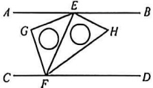

如图，$AB \parallel CD$，一副三角尺按如图所示放置，$\angle AEG=20$ 度，则 $\angle HFD$ 为 ___ 度。

> [!question]- 点击查看答案与解析
> 【答案】$25$
> 
> 【考点】平行线的性质，三角形内角和 → [[【初中数学知识点体系-人教版】#7-2 平行线]]
> 
> 【解析】
> - 由图可知，三角尺 $GEF$ 中，$\angle GEF=90^{\circ}$（直角），$\angle GFE=45^{\circ}$
> - $\angle AEG=20^{\circ}$
> - $\angle AEF=\angle AEG+\angle GEF=20^{\circ}+90^{\circ}=110^{\circ}$
> - ∵ $AB\parallel CD$
> - ∴ $\angle EFD=180^{\circ}-\angle AEF=180^{\circ}-110^{\circ}=70^{\circ}$（同旁内角互补）
> - $\angle HFD=\angle EFD-\angle EFH=70^{\circ}-45^{\circ}=25^{\circ}$
> 
> 【易错点】需要根据图形准确分析角的关系，注意三角尺各角的度数。
