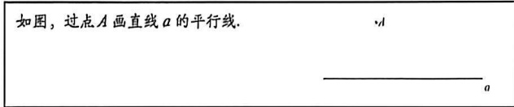
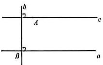

数学课上，老师请同学们思考如下问题：

如图，过点 $A$ 画直线 $a$ 的平行线。

小军同学的画法如下：

如图，在直线 $a$ 上任取一点 $B$，过点 $B$ 画直线 $a$ 的垂线 $b$；过点 $A$ 画直线 $b$ 的垂线 $c$。直线 $c$ 即为所求。

老师说，小军的画法正确。

请回答：小军画图的依据是：___

> [!question]- 点击查看答案与解析
> 【答案】在同一平面内，垂直于同一条直线的两条直线平行
> 
> 【考点】平行线的判定 → [[【初中数学知识点体系-人教版】#7-2 平行线]]
> 
> 【解析】
> - 小军的画法：$a\perp b$，$c\perp b$
> - 根据平行线的判定定理：在同一平面内，垂直于同一条直线的两条直线平行
> - ∴ $a\parallel c$
> 
> 【易错点】需要完整表述定理，不能遗漏"在同一平面内"这一前提条件。
