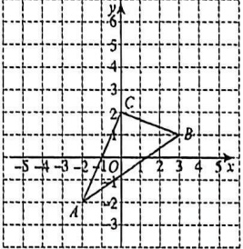

如图，在平面直角坐标系 $xOy$ 中，三角形 $ABC$ 三个顶点的坐标分别为 $(-2,-2)$，$(3,1)$，$(0,2)$，若把三角形 $ABC$ 向上平移 3 个单位长度，再向左平移 1 个单位长度得到三角形 $A'B'C'$，点 $A$，$B$，$C$ 的对应点分别为 $A'$，$B'$，$C'$。

（1）写出点 $A'$，$B'$，$C'$ 的坐标：

（2）在图中画出平移后的三角形 $A'B'C'$

（3）三角形 $A'B'C'$ 的面积为 ___ .

> [!question]- 点击查看答案与解析
> 【答案】（1）$A'(-3,1)$，$B'(2,4)$，$C'(-1,5)$；（3）$\dfrac{15}{2}$
>
> 【考点】坐标与图形的平移 → [[【初中数学知识点体系-人教版】#9-2 坐标方法的简单应用]]
>
> 【解析】
> （1）向上平移3个单位，纵坐标加3；向左平移1个单位，横坐标减1
>
> $A(-2,-2)\to A'(-3,1)$
>
> $B(3,1)\to B'(2,4)$
>
> $C(0,2)\to C'(-1,5)$
>
> （3）三角形 $A'B'C'$ 的面积
>
> $S=\dfrac{1}{2}\left|x_{A'}(y_{B'}-y_{C'})+x_{B'}(y_{C'}-y_{A'})+x_{C'}(y_{A'}-y_{B'})\right|$
>
> $=\dfrac{1}{2}\left|(-3)(4-5)+2(5-1)+(-1)(1-4)\right|$
>
> $=\dfrac{1}{2}\left|3+8+3\right|$
>
> $=\dfrac{15}{2}$
>
> 【易错点】平移时坐标的变化规律要记准，面积计算要仔细。
