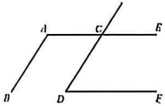

按要求完成下列证明：

已知：如图，$AB \parallel CD$，直线 $AE$ 交 $CD$ 于点 $C$，$\angle BAC+\angle CDF=180^{\circ}$

求证：$AE \parallel DF$。

证明：∵ $AB \parallel CD$（ ___ ），

$\therefore \angle BAC=\angle DCE$（ ___ ）。

$\because \angle BAC+\angle CDF=180^{\circ}$（已知）

$\therefore\underline{\quad\quad\quad}+\angle CDF=180^{\circ}\quad\left(\underline{\quad\quad\quad}\right).$

$\therefore AE \parallel DF$（ ___ ）.

> [!question]- 点击查看答案与解析
> 【答案】已知；两直线平行，内错角相等；$\angle ACD$；同旁内角互补，两直线平行
> 
> 【考点】平行线的性质与判定 → [[【初中数学知识点体系-人教版】#7-2 平行线]]
> 
> 【解析】
> ∵ $AB \parallel CD$（已知），
> 
> $\therefore \angle BAC=\angle ACD$（两直线平行，内错角相等）。
> 
> ∵ $\angle BAC+\angle CDF=180^{\circ}$（已知）
> 
> $\therefore \angle ACD+\angle CDF=180^{\circ}$（等量代换）。
> 
> $\therefore AE \parallel DF$（同旁内角互补，两直线平行）。
> 
> 【易错点】注意 $\angle BAC$ 与 $\angle ACD$ 是内错角（$AB$、$CD$ 被截线 $AC$ 所截），不是对顶角。对顶角必须在同一顶点，而 $\angle BAC$ 顶点为 $A$，$\angle DCE$ 顶点为 $C$，二者不可能是对顶角。
