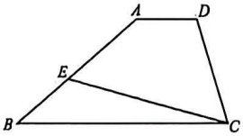

在四边形 $ABCD$ 中，$AD \parallel BC$，$E$ 为 $AB$ 边上一点，$\angle BCE=15^{\circ}$，$EF \parallel AD$ 交 $DC$ 于点 $F$。

（1）依题意补全图形，求 $\angle FEC$ 的度数：

（2）若 $\angle A=140^{\circ}$，求 $\angle AEC$ 的度数。

> [!question]- 点击查看答案与解析
> 【答案】（1）$\angle FEC=15^{\circ}$；（2）$\angle AEC=55^{\circ}$
> 
> 【考点】平行线的性质 → [[【初中数学知识点体系-人教版】#7-2 平行线]]
> 
> 【解析】
> （1）∵ $AD \parallel BC$，$EF \parallel AD$
> 
> ∴ $EF \parallel BC$
> 
> ∴ $\angle FEC = \angle BCE = 15^{\circ}$（两直线平行，内错角相等）
> 
> （2）∵ $AD \parallel BC$，$\angle A = 140^{\circ}$
> 
> ∴ $\angle B = 180^{\circ} - 140^{\circ} = 40^{\circ}$（同旁内角互补）
> 
> 在 $\triangle BEC$ 中：
> 
> $\angle BEC = 180^{\circ} - \angle B - \angle BCE = 180^{\circ} - 40^{\circ} - 15^{\circ} = 125^{\circ}$
> 
> ∵ $E$ 在 $AB$ 上，$\angle AEC$ 与 $\angle BEC$ 互补
> 
> ∴ $\angle AEC = 180^{\circ} - 125^{\circ} = 55^{\circ}$
> 
> 【易错点】利用平行线性质找角的关系时，要准确判断是同位角、内错角还是同旁内角。
