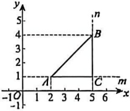

对于平面直角坐标系 $xOy$ 中的点 $A$，给出如下定义：若存在点 $B$（不与点 $A$ 重合，且直线 $AB$ 不与坐标轴平行或重合），过点 $A$ 作直线 $m \parallel x$ 轴，过点 $B$ 作直线 $n \parallel y$ 轴，直线 $m$，$n$ 相交于点 $C$。当线段 $AC$，$BC$ 的长度相等时，等距面积。例如：如图，点 $A(2,1)$，点 $B(5,4)$，因为 $AC=BC=3$，所以 $B$ 为点 $A$ 的等距点，此时点 $A$ 的等距面积为 $\frac{9}{2}$。

（1）点 $A$ 的坐标是 $(0,1)$，在点 $B_1(-1,0)$，$B_2(2,3)$，$B_3(-1,-1)$ 中，点 $A$ 的等距点为 ___ 。

（2）点 $A$ 的坐标是 $(-3,1)$，点 $A$ 的等距点 $B$ 在第三象限，

$①$ 若点 $B$ 的坐标是 $\left(-\frac{9}{2},-\frac{1}{2}\right)$，求此时点 $A$ 的等距面积；

$②$ 若点 $A$ 的等距面积不小于 $\frac{9}{8}$，求此时点 $B$ 的横坐标 $t$ 的取值范围。

> [!question]- 点击查看答案与解析
> 【答案】（1）$B_1$，$B_2$；（2）$①$ $\dfrac{9}{8}$；$②$ $-\dfrac{3}{2}\leqslant t<0$ 或 $t\leqslant-\dfrac{9}{2}$
> 
> 【考点】坐标与图形的新定义问题 → [[【初中数学知识点体系-人教版】#9-1 用坐标描述平面内点的位置]]
> 
> 【解析】
> **定义分析**：过 $A(x_A,y_A)$ 作 $m\parallel x$ 轴，过 $B(x_B,y_B)$ 作 $n\parallel y$ 轴，交点 $C(x_B,y_A)$。
> - $AC=|x_B-x_A|$，$BC=|y_A-y_B|$
> - 等距条件：$AC=BC$
> - 等距面积 $=\dfrac{1}{2}\times AC\times BC=\dfrac{1}{2}AC^2$
> 
> **（1）** $A(0,1)$：
> - $B_1(-1,0)$：$C(-1,1)$，$AC=|-1-0|=1$，$BC=|1-0|=1$，$AC=BC=1$ ✓；直线 $AB_1$ 斜率 $=\frac{0-1}{-1-0}=1$（不与坐标轴平行）✓
> - $B_2(2,3)$：$C(2,1)$，$AC=|2-0|=2$，$BC=|1-3|=2$，$AC=BC=2$ ✓；直线 $AB_2$ 斜率 $=\frac{3-1}{2-0}=1$ ✓
> - $B_3(-1,-1)$：$C(-1,1)$，$AC=|-1-0|=1$，$BC=|1-(-1)|=2$，$AC\neq BC$ ✗
> 
> ∴ 等距点为 $B_1$，$B_2$
> 
> **（2）$①$** $A(-3,1)$，$B\left(-\dfrac{9}{2},-\dfrac{1}{2}\right)$：
> - $C\left(-\dfrac{9}{2},1\right)$
> - $AC=\left|-\dfrac{9}{2}-(-3)\right|=\left|-\dfrac{3}{2}\right|=\dfrac{3}{2}$
> - $BC=\left|1-\left(-\dfrac{1}{2}\right)\right|=\dfrac{3}{2}$
> - $AC=BC=\dfrac{3}{2}$ ✓
> - 等距面积 $=\dfrac{1}{2}\times\left(\dfrac{3}{2}\right)^2=\dfrac{1}{2}\times\dfrac{9}{4}=\dfrac{9}{8}$
> 
> **$②$** 设 $B(t,y_B)$，$t<0$，$y_B<0$（第三象限）：
> - $C(t,1)$
> - $AC=|t-(-3)|=|t+3|$
> - $BC=|1-y_B|=1-y_B$（因 $y_B<0$，故 $1-y_B>0$）
> - 等距条件：$|t+3|=1-y_B$，即 $y_B=1-|t+3|$
> - 等距面积 $=\dfrac{1}{2}(t+3)^2$
> 
> 由等距面积不小于 $\dfrac{9}{8}$：
> $\dfrac{1}{2}(t+3)^2\geqslant\dfrac{9}{8}$
> 
> $(t+3)^2\geqslant\dfrac{9}{4}$
> 
> $|t+3|\geqslant\dfrac{3}{2}$
> 
> 即 $t+3\geqslant\dfrac{3}{2}$ 或 $t+3\leqslant-\dfrac{3}{2}$
> 
> 解得 $t\geqslant-\dfrac{3}{2}$ 或 $t\leqslant-\dfrac{9}{2}$
> 
> 结合 $t<0$ 及 $y_B<0$（即 $|t+3|>1$，解得 $t>-2$ 或 $t<-4$）：
> - 当 $t\geqslant-\dfrac{3}{2}$ 时：$-\dfrac{3}{2}\leqslant t<0$（满足 $t>-2$）
> - 当 $t\leqslant-\dfrac{9}{2}$ 时：$t\leqslant-\dfrac{9}{2}$（满足 $t<-4$）
> 
> ∴ $t$ 的取值范围为 $-\dfrac{3}{2}\leqslant t<0$ 或 $t\leqslant-\dfrac{9}{2}$
> 
> 【易错点】新定义问题要先理解"等距点"和"等距面积"的含义，注意 $C$ 点坐标的确定方法（$C$ 的横坐标等于 $B$ 的横坐标，纵坐标等于 $A$ 的纵坐标），以及第三象限点的横纵坐标都为负的限制条件。
