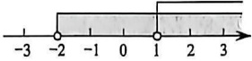
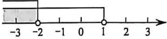
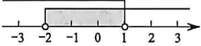
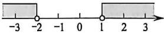

不等式组 $\begin{cases} x > -2 \\ x < 1 \end{cases}$ 的解集在数轴上表示正确的是（ ）

A.

B.

C.

D.

> [!question]- 点击查看答案与解析
> 【答案】B
> 
> 【考点】不等式组的解集在数轴上的表示 → [[【初中数学知识点体系-人教版】#11-3 一元一次不等式组]]
> 
> 【解析】
> - 不等式组 $\begin{cases} x > -2 \\ x < 1 \end{cases}$ 的解集为 $-2 < x < 1$
> - 在数轴上表示时，$-2$ 和 $1$ 处都应为空心圆点，且两点之间的部分为解集
> - 选项A：$-2$ 处为实心圆点，错误
> - 选项B：$-2$ 和 $1$ 处均为空心圆点，且中间部分为解集，正确
> - 选项C：解集方向错误，错误
> - 选项D：$1$ 处为实心圆点，错误
> 
> 【易错点】严格不等式（$>$、$<$）对应空心圆点，非严格不等式（$\geqslant$、$\leqslant$）对应实心圆点。
