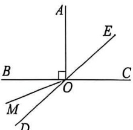

如图，直线 BC，DE 相交于点 O，$AO \perp BC$ 于点 O. OM 平分 $\angle BOD$，如果 $\angle AOE = 50^\circ$，那么 $\angle BOM$ 的度数是（ ）

A. $20^\circ$

B. $25^\circ$

C. $40^\circ$

D. $50^\circ$

> [!question]- 点击查看答案与解析
> 【答案】A
> 
> 【考点】角平分线、垂直的定义，角的计算 → [[【初中数学知识点体系-人教版】#6-3 角]]
> 
> 【解析】
> - ∵ $AO \perp BC$ 于点 $O$
> - ∴ $\angle AOB = 90^{\circ}$
> - ∵ $\angle AOE = 50^{\circ}$
> - ∴ $\angle BOE = \angle AOB + \angle AOE = 90^{\circ} + 50^{\circ} = 140^{\circ}$
> - ∵ $DE$ 是直线
> - ∴ $\angle BOD = 180^{\circ} - \angle BOE = 180^{\circ} - 140^{\circ} = 40^{\circ}$
> - ∵ $OM$ 平分 $\angle BOD$
> - ∴ $\angle BOM = \dfrac{1}{2}\angle BOD = 20^{\circ}$
> 
> 【易错点】需要根据图形准确判断角的位置关系，注意角的加减。
