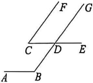

如图，要使 $CF \parallel BG$，你认为应该添加的一个条件是 ___ .

> [!question]- 点击查看答案与解析
> 【答案】$\angle ACF = \angle ABG$（答案不唯一）
> 
> 【考点】平行线的判定 → [[【初中数学知识点体系-人教版】#7-2 平行线]]
> 
> 【解析】
> - 要使 $CF \parallel BG$，可以根据平行线的判定定理
> - 添加条件：$\angle ACF = \angle ABG$（同位角相等，两直线平行）
> - 或 $\angle FCB = \angle GBC$（内错角相等，两直线平行）
> - 或 $\angle FCB + \angle CBG = 180^{\circ}$（同旁内角互补，两直线平行）
> 
> 【易错点】平行线的判定定理有三种，需要根据图形选择合适的条件。
