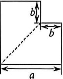
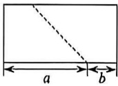

如图1，将边长为 $a$ 的大正方形剪去一个边长为 $b$ 的小正方形，并沿图中的虚线剪开，拼接后得到图2，请根据图形的面积写出一个含字母 $a$，$b$ 的等式 ___ 。

图1 

图2 

> [!question]- 点击查看答案与解析
> 【答案】$a^2 - b^2 = (a + b)(a - b)$
> 
> 【考点】平方差公式的几何意义 → [[【初中数学知识点体系-人教版】#16-3 乘法公式]]
> 
> 【解析】
> - 大正方形面积 $= a^2$
> - 小正方形面积 $= b^2$
> - 剩余部分面积 $= a^2 - b^2$
> - 拼接后得到长方形，长为 $a + b$，宽为 $a - b$
> - 长方形面积 $= (a + b)(a - b)$
> - ∴ $a^2 - b^2 = (a + b)(a - b)$
> 
> 【易错点】需要通过图形面积的关系理解平方差公式。
