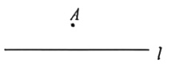
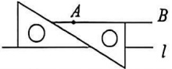

在数学课上，老师提出如下问题：

已知：直线 $l$ 及其外一点 $A$.

求作：$l$ 的平行线，使它经过点 $A$.

小菲用两块形状、大小相同的三角尺完成了该题的作图，作法如下：

如图，

（1）用第一块三角尺的一条边贴住直线 $l$，第二块三角尺的一条边紧靠第一块三角尺；

（2）将第二块三角尺沿第一块三角尺移动，使其另一边经过点 $A$，沿这边作出直线 $AB$.

所以，直线 $AB$ 即为所求。

老师说：“小菲的作法正确。”

请回答：小菲的作图依据是 ___ 。

> [!question]- 点击查看答案与解析
> 【答案】同位角相等，两直线平行（或内错角相等，两直线平行）
> 
> 【考点】平行线的判定（作图依据）→ [[【初中数学知识点体系-人教版】#7-2 平行线]]
> 
> 【解析】
> - 小菲用两块相同的三角板作图
> - 两块三角板的对应角相等
> - 通过平移，使得同位角（或内错角）相等
> - 根据平行线的判定定理：同位角相等，两直线平行
> 
> 【易错点】需要理解三角板作图的原理，本质是利用了平行线的判定定理。
