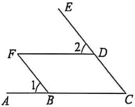

已知：如图，$CBA$，$CDE$ 都是射线，点 $F$ 是 $\angle ACE$ 内一点，且 $\angle 1 = \angle C$，$FD \parallel AC$。求证：（1）$FB \parallel EC$；（2）$\angle 1 = \angle 2$。

> [!question]- 点击查看答案与解析
> 【答案】见解析
> 
> 【考点】平行线的判定与性质 → [[【初中数学知识点体系-人教版】#7-2 平行线]]
> 
> 【解析】
> 证明：
> （1）∵ $\angle 1 = \angle C$
> 
> ∴ $FB \parallel EC$（同位角相等，两直线平行）
> 
> （2）∵ $FD \parallel AC$
> 
> ∴ $\angle 2 = \angle C$（两直线平行，内错角相等）
> 
> 又∵ $\angle 1 = \angle C$
> 
> ∴ $\angle 1 = \angle 2$
> 
> 【易错点】平行线的性质和判定要区分清楚，"同位角相等"是判定，"两直线平行，同位角相等"是性质。
