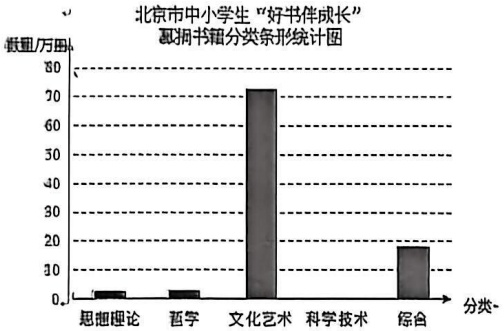
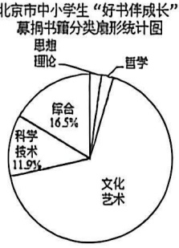

阅读下列材料：2017年年底，共青团北京市委确定了未来3年对口援疆工作内容。在与新疆和田当地教育部门、学校交流过程中，共青团北京市委了解到，和田地区中小学汉语课外读物匮乏。根据对口援疆工作安排，结合和田地区对图书的实际需求，2018年1月5日起，共青团北京市委组织东城、西城、朝阳、海淀、丰台、石景山六个区近 900 所中小学校，按照和田地区中小学提供的需求图书种类，开展“好书伴成长”募捐书籍活动。活动中，师生踊跃参与，短短两周，已募捐百万余册图书。截至1月19日，分别收到思想理论约2.6万册、哲学约2.6万册、文学艺术约 72.6 万册、综合约 18.0 万册，及科学技术五大类书籍，这些图书最终通过火车集中运送至新疆和田。根据相关统计数据，绘制了如下统计图：

（以上数据来源于新浪网站） 

根据以上材料解答下列问题：

（1）此次活动中，北京市中小学生一共捐书约为 ___ 万册（保留整数），并将条形统计图补充完整：

（2）在扇形统计图中，文化艺术类所在扇形的圆心角约为 ___ 度（保留整数）：

（3）根据本次活动的数据统计分析，写出你对同学们捐书的一条感受或建议。

> [!question]- 点击查看答案与解析
> 【答案】（1）100；（2）84°
> 
> 【考点】统计图表的分析 → [[【初中数学知识点体系-人教版】#12-2 用统计图描述数据]]
> 
> 【解析】
> （1）总捐书量 $= 2.6 + 2.6 + 72.6 + 18.0 +$ 科学技术类
> 
> 从条形图读取科学技术类约为6.8万册
> 
> 总捐书量 $\approx 2.6 + 2.6 + 72.6 + 18.0 + 6.8 = 102.6 \approx 100$（万册）
> 
> （2）从扇形图读取，文化艺术类占比约为23%
> 
> 圆心角 $= 23\% \times 360^{\circ} \approx 84^{\circ}$
> 
> （3）感受或建议：同学们捐书以文学艺术类为主，其他类别相对较少，建议增加科学技术类和哲学类书籍的捐赠，使书籍种类更加均衡。
> 
> 【易错点】读图要仔细，计算要准确，保留整数时要四舍五入。
