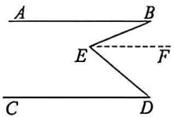
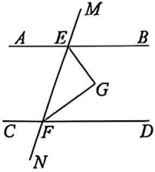
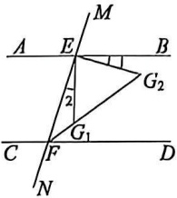

阅读下列材料：

已知：如图1，直线 $AB \parallel CD$，点 $E$ 是 $AB$、$CD$ 上一点，连接 $BE$、$DE$，得到 $\angle BED$.
求证：$\angle BED = \angle B + \angle D$.

小冰是这样做的：

证明：过点 $E$ 作 $EF \parallel AB$，则有 $\angle BEF = \angle B$.
∵ $AB \parallel CD$，∴ $EF \parallel CD$.
∴ $\angle FED = \angle D$.
∴ $\angle BEF + \angle FED = \angle B + \angle D$.
即 $\angle BED = \angle B + \angle D$.

图1 

请利用材料中的结论，完成下面的问题：

已知：直线 $AB \parallel CD$，直线 $MN$ 分别与 $AB$、$CD$ 交于点 $E$、$F$.

（1）如图2，$\angle BEF$ 和$\angle EFD$ 的平分线交于点$G$. 猜想$\angle G$ 的度数，并证明你的猜想；

（2）如图3，$EG_1$ 和 $EG_2$ 为 $\angle BEF$ 内满足 $\angle 1 = \angle 2$ 的两条线，分别与 $\angle EFD$ 的平分线交于点 $G_1$ 和 $G_2$，求证：$\angle FG_1E + \angle G_2 = 180^\circ$。

图2 

图3 

> [!question]- 点击查看答案与解析
> 【答案】（1）$\angle G = 90^{\circ}$；（2）见解析
> 
> 【考点】平行线的性质，角平分线 → [[【初中数学知识点体系-人教版】#7-2 平行线]]
> 
> 【解析】
> （1）猜想：$\angle G = 90^{\circ}$
> 
> 证明：∵ $AB \parallel CD$
> 
> ∴ $\angle BEF + \angle EFD = 180^{\circ}$（两直线平行，同旁内角互补）
> 
> ∵ $EG$ 平分 $\angle BEF$，$FG$ 平分 $\angle EFD$
> 
> ∴ $\angle GEF = \dfrac{1}{2}\angle BEF$，$\angle GFE = \dfrac{1}{2}\angle EFD$
> 
> ∴ $\angle GEF + \angle GFE = \dfrac{1}{2}(\angle BEF + \angle EFD) = \dfrac{1}{2} \times 180^{\circ} = 90^{\circ}$
> 
> 在 $\triangle EGF$ 中：
> 
> $\angle G = 180^{\circ} - (\angle GEF + \angle GFE) = 180^{\circ} - 90^{\circ} = 90^{\circ}$
> 
> （2）证明：设 $\angle 1 = \angle 2 = \gamma$
> 
> ∵ $AB \parallel CD$
> 
> ∴ $\angle BEF + \angle EFD = 180^{\circ}$
> 
> 设 $\angle BEF = \angle 1 + \angle 2 + \angle G_2EF = 2\gamma + \angle G_2EF$
> 
> 设 $\angle EFD = 2\beta$（$FG_1$、$FG_2$ 平分 $\angle EFD$，$\angle EFG_1 = \angle EFG_2 = \beta$）
> 
> ∴ $2\gamma + \angle G_2EF + 2\beta = 180^{\circ}$
> 
> 在 $\triangle EG_1F$ 中：
> 
> $\angle FG_1E = 180^{\circ} - \angle G_1EF - \angle EFG_1$
> 
> 其中 $\angle G_1EF = \angle 1 + \angle 2 = 2\gamma$，$\angle EFG_1 = \beta$
> 
> ∴ $\angle FG_1E = 180^{\circ} - 2\gamma - \beta$
> 
> 在 $\triangle EG_2F$ 中：
> 
> $\angle G_2 = 180^{\circ} - \angle G_2EF - \angle EFG_2$
> 
> 其中 $\angle G_2EF = 180^{\circ} - 2\gamma - 2\beta$，$\angle EFG_2 = \beta$
> 
> ∴ $\angle G_2 = 180^{\circ} - (180^{\circ} - 2\gamma - 2\beta) - \beta = 2\gamma + \beta$
> 
> ∴ $\angle FG_1E + \angle G_2 = (180^{\circ} - 2\gamma - \beta) + (2\gamma + \beta) = 180^{\circ}$
> 
> 【易错点】角平分线将角等分，需要设未知数表示各角，利用平行线的性质建立等量关系。
