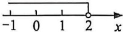
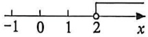
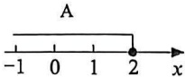
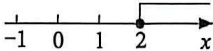

在数轴上表示不等式 $-x+2\leq0$ 的解集，正确的是（）

A.

B.

C.

D.

> [!question]- 点击查看答案与解析
> 【答案】B
> 
> 【考点】不等式的解集在数轴上的表示 → [[【初中数学知识点体系-人教版】#11-2 一元一次不等式]]
> 
> 【解析】
> - 解不等式 $-x+2\leq0$
> - 移项得：$-x\leq-2$
> - 两边乘以 $-1$（不等号方向改变）：$x\geq2$
> - 在数轴上表示：从 $2$ 向右画，$2$ 处为实心圆点
> - 选项B符合
> 
> 【易错点】不等式两边乘以负数时，不等号方向要改变。
