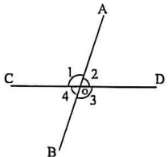

如图，直线 $AB$、$CD$ 相交于点 $O$，下列描述：

$①$ $\angle 1$ 和 $\angle 2$ 互为对顶角

$②$ $\angle 1$ 和 $\angle 2$ 互为邻补角

$③$ $\angle 1=\angle 2$

$④$ $\angle 1=\angle 3$

其中正确的是（）

A. $①③$

B. $②④$

C. $②③$

D. $①④$

> [!question]- 点击查看答案与解析
> 【答案】A
> 
> 【考点】对顶角、邻补角的定义 → [[【初中数学知识点体系-人教版】#7-1 相交线]]
> 
> 【解析】
> - 根据图形，$\angle 1$ 和 $\angle 2$ 是对顶角
> - $①$ $\angle 1$ 和 $\angle 2$ 互为对顶角，正确
> - $②$ $\angle 1$ 和 $\angle 2$ 互为邻补角，错误（对顶角不是邻补角）
> - $③$ $\angle 1=\angle 2$，正确（对顶角相等）
> - $④$ $\angle 1=\angle 3$，错误（$\angle 1$ 和 $\angle 3$ 是邻补角，和为 $180^{\circ}$）
> - 正确的是 $①③$，选A
> 
> 【易错点】对顶角相等，邻补角互补（和为 $180^{\circ}$）。
