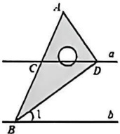

含 $30^{\circ}$ 角的直角三角板与直线 $a$，$b$ 的位置关系如图所示，已知 $a\parallel b$，$\angle 1=35^{\circ}$。则 $\angle ADC$ 的度数是（）

A. $55^{\circ}$

B. $35^{\circ}$

C. $65^{\circ}$

D. $45^{\circ}$

> [!question]- 点击查看答案与解析
> 【答案】A
> 
> 【考点】平行线的性质，直角三角形的性质 → [[【初中数学知识点体系-人教版】#7-2 平行线]]
> 
> 【解析】
> - 含 $30^{\circ}$ 角的直角三角板，$\angle ACB=90^{\circ}$
> - ∵ $a\parallel b$，$\angle 1=35^{\circ}$
> - 根据图形，$\angle 1$ 和 $\angle ADC$ 是 $\angle ACB=90^{\circ}$ 在两条平行线间形成的两个角
> - ∴ $\angle ADC=90^{\circ}-\angle 1=90^{\circ}-35^{\circ}=55^{\circ}$
> - 选项A：$55^{\circ}$，正确
> - 选项B：$35^{\circ}$，错误
> - 选项C：$65^{\circ}$，错误
> - 选项D：$45^{\circ}$，错误
> 
> 【易错点】直角在两条平行线间时，直角被分成的两个角之和为 $90^{\circ}$，需要结合平行线的性质分析。
