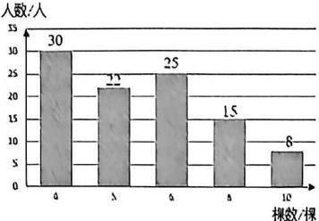

某校在 "爱护地球，绿化祖国" 的活动中，组织同学开展植树造林活动，为了了解全校同学的植树情况，学校随机抽查了一部分同学的植树情况，将调查数据整理绘制成如下所示的统计图．下面有四个推断：

$①$ 这次调查获取的样本数据的样本容量是 100;

$②$ 这次调查获取的样本数据的中位数是 6 棵;

$③$ 这次调查获取的样本数据的众数是 4 棵;

$④$ 这次调查获取的样本数据的平均数是 8 棵.

其中合理的是 ( )

A. $①②$

B. $①③$

C. $②③$

D. $②④$

> [!question]- 点击查看答案与解析
> 【答案】B
> 
> 【考点】统计图表的分析 → [[【初中数学知识点体系-人教版】#12-1 统计调查]]
> 
> 【解析】
> - $①$ 样本容量：从条形图读取各植树数量的频数，相加得100，正确
> - $②$ 中位数：100个数据，中位数是第50、51个数据的平均数，从条形图看，中位数是6棵，正确
> - $③$ 众数：出现次数最多的是4棵，正确
> - $④$ 平均数：需要计算加权平均数，不是8棵，错误
> - 合理的是 $①③$，选B
> 
> 【易错点】中位数、众数、平均数的概念要区分清楚。
