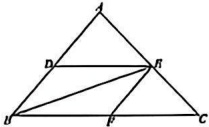

已知：如图 $\triangle ABC$ 中，点 $D$、$E$、$F$ 分别在 $AB$、$AC$、$BC$ 上，连接 $DE$、$BE$、$EF$，要使 $DE\parallel BC$，你认为应该添加的条件是 ___ 。

> [!question]- 点击查看答案与解析
> 【答案】$\angle ADE=\angle B$（答案不唯一）
> 
> 【考点】平行线的判定 → [[【初中数学知识点体系-人教版】#7-2 平行线]]
> 
> 【解析】
> - 要使 $DE\parallel BC$，可以根据平行线的判定定理
> - 添加条件：$\angle ADE=\angle B$（同位角相等，两直线平行）
> - 或 $\angle AED=\angle C$（同位角相等，两直线平行）
> - 或 $\frac{AD}{AB}=\frac{AE}{AC}$（平行线分线段成比例）
> 
> 【易错点】平行线的判定定理有多种，需要根据图形选择合适的条件。
