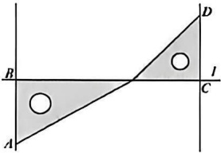

在数学课上，老师要求同学们利用一副三角板画出两条平行线．小明的画法如下：

步骤一：运用三角板一边任意画一条直线 $l_{1}$

步骤二：按如图方式摆放三角板：

步骤三：沿三角板的直角边画出直线 $AB$、$CD$；

这样，得到 $AB\parallel CD$ .

小明这样画图的依据是 ___ 。

> [!question]- 点击查看答案与解析
> 【答案】同位角相等，两直线平行
> 
> 【考点】平行线的判定 → [[【初中数学知识点体系-人教版】#7-2 平行线]]
> 
> 【解析】
> - 小明利用三角板的直角边画平行线
> - 两块三角板的对应角相等（都是 $90^{\circ}$）
> - 通过平移，使得同位角相等
> - 根据平行线的判定定理：同位角相等，两直线平行
> 
> 【易错点】需要理解三角板作图的原理，本质是利用了平行线的判定定理。
