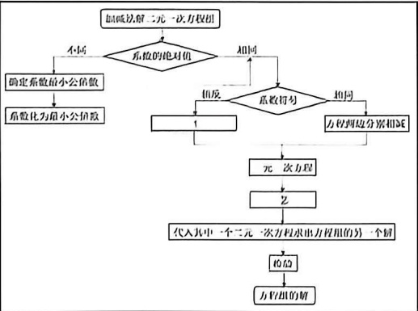

学习了二元一次方程组的解法后，小聪同学画出了下图：

请问图中 $①$ 为 ___ ，$②$ 为 ___ 。

> [!question]- 点击查看答案与解析
> 【答案】$①$ 代入消元法，$②$ 加减消元法
> 
> 【考点】二元一次方程组的解法 → [[【初中数学知识点体系-人教版】#10-2 消元——解二元一次方程组]]
> 
> 【解析】
> - 从流程图可以看出，解二元一次方程组有两种方法
> - $①$ 代入消元法：将一个方程变形后代入另一个方程
> - $②$ 加减消元法：通过加减消去一个未知数
> 
> 【易错点】两种消元法的名称要记准。
