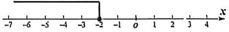

本学期学习了一元一次不等式的解法，下面是甲同学的解题过程：

解不等式 $\frac{x-2}{2}-1\leq\frac{5x+1}{4}$

解：不等式两边同时乘以4，得：$\frac{x-2}{2}\times4-1\leq\frac{5x+1}{4}\times4$ ……$①$

去分母，得：$2(x-2)-1\leq5x+1$ ……$②$

去括号，得：$2x-4-1\leq5x+1$ ……$③$

移项，得：$2x-5x\leq1+1+4$ ……$④$

合并同类项，得：$-3x\leq6$ ……$⑤$

系数化1，得：$x\leq-2$ ……$⑥$

不等式的解集在数轴上表示为：

上述甲同学的解题过程从第 ___ 步开始出现错误，错误的原因是 ___ .

请帮甲同学改正错误，写出完整的解题过程，并把正确解集在数轴上表示出来.

> [!question]- 点击查看答案与解析
> 【答案】从第 $①$ 步开始出现错误，错误的原因是不等式两边同时乘以4时，$-1$ 没有乘以4；正确解集为 $x\geq-3$
> 
> 【考点】一元一次不等式的解法 → [[【初中数学知识点体系-人教版】#11-2 一元一次不等式]]
> 
> 【解析】
> - 第 $①$ 步：不等式两边同时乘以4时，应该是 $\frac{x-2}{2}\times4-1\times4\leq\frac{5x+1}{4}\times4$
> - 即 $2(x-2)-4\leq5x+1$
> - 错误原因：$-1$ 没有乘以4
> - 正确解题过程：
> $\frac{x-2}{2}-1\leq\frac{5x+1}{4}$
> 
> 两边同时乘以4：$2(x-2)-4\leq5x+1$
> 
> 去括号：$2x-4-4\leq5x+1$
> 
> 移项：$2x-5x\leq1+4+4$
> 
> 合并同类项：$-3x\leq9$
> 
> 系数化为1：$x\geq-3$
> 
> 在数轴上表示：从 $-3$ 向右画，$-3$ 处为实心圆点。
> 
> 【易错点】不等式两边同时乘以一个数时，每一项都要乘以这个数，不要漏项。
