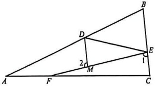

完成下面的证明：

已知：如图，点 $D$，$E$，$F$ 分别在线段 $AB$，$BC$，$AC$ 上，连接 $DE$、$EF$，$DM$ 平分 $\angle ADE$ 交 $EF$ 于点 $M$，$\angle 1+\angle 2=180^{\circ}$，求证：$\angle B=\angle BED$ .

证明：∵ $\angle 1+\angle 2=180^\circ$（已知），

又∵ $\angle 1+\angle BEM=180^{\circ}$（平角定义），

$\therefore \angle 2=\angle BEM$ ( ___ )，

$\therefore DM\parallel$ ___ （ ___ ）.

$\therefore \angle ADM=\angle B$ ( ___ )，

$\angle MDE=\angle BED$ ( ___ ).

又∵ DM 平分 $\angle ADE$（已知），

$\therefore \angle ADM=\angle MDE$（角平分线定义）.

$\therefore \angle B=\angle BED$（等量代换）.

> [!question]- 点击查看答案与解析
> 【答案】见解析
> 
> 【考点】平行线的判定与性质 → [[【初中数学知识点体系-人教版】#7-2 平行线]]
> 
> 【解析】
> 证明：
> ∵ $\angle 1+\angle 2=180^{\circ}$（已知）
> 
> 又∵ $\angle 1+\angle BEM=180^{\circ}$（平角定义）
> 
> ∴ $\angle 2=\angle BEM$（同角的补角相等）
> 
> ∴ $DM\parallel BE$（同位角相等，两直线平行）
> 
> ∴ $\angle ADM=\angle B$（两直线平行，同位角相等）
> 
> $\angle MDE=\angle BED$（两直线平行，内错角相等）
> 
> 又∵ $DM$ 平分 $\angle ADE$（已知）
> 
> ∴ $\angle ADM=\angle MDE$（角平分线定义）
> 
> ∴ $\angle B=\angle BED$（等量代换）
> 
> 【易错点】平行线的性质和判定要区分清楚，"同位角相等"是判定，"两直线平行，同位角相等"是性质。
