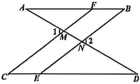

已知：如图，$\angle 1=\angle 2$，$\angle B=\angle C$ .

（1）求证 $AB\parallel CD$

（2）若 $\angle A=30^{\circ}$，求 $\angle D$ 的度数.

> [!question]- 点击查看答案与解析
> 【答案】（1）见解析；（2）$30^{\circ}$
> 
> 【考点】平行线的判定与性质 → [[【初中数学知识点体系-人教版】#7-2 平行线]]
> 
> 【解析】
> （1）证明：
> ∵ $\angle 1=\angle 2$（已知）
> 
> ∴ $AB\parallel CD$（内错角相等，两直线平行）
> 
> （2）∵ $AB\parallel CD$
> 
> ∴ $\angle A=\angle D$（内错角相等）
> 
> ∵ $\angle A=30^{\circ}$
> 
> ∴ $\angle D=30^{\circ}$
> 
> 【易错点】需要根据图形准确分析角的关系，平行线的性质要正确应用。
