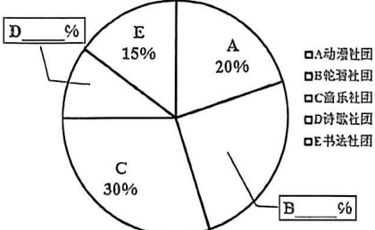

为了丰富学生校园生活，满足学生的多元文化需求，促进学生身心健康和谐发展，学校开展了丰富多彩的社团活动。我区某中学开展的社团活动有 A. 动漫社团； B. 轮滑社团； C. 音乐社团； D. 诗歌社团； E. 书法社团。学生管理中心为了了解全校 500 名学生的社团需求，开展了一次调查研究，请将下面的调查过程补全。

抽样调查：学生管理中心计划选取 40 名学生进行问卷调研，下面的抽样方法中，合理的是 ___ （填序号）；

$①$ 从九年级1班、2班各随机抽取 20 名学生进行问卷调研；

$②$ 从七、八、九三个年级中随机抽取 40 名女生进行问卷调研：

$③$ 从七、八、九三个年级中随机抽取男女生各 20 名进行问卷调研.

收集数据：抽样方法确定后，学生管理中心收集到如下数据（社团项目的编号，用字母代号表示）

B, E, B, A, E, C, C, C, B, B,

A, C, E, D, B, A, B, E, C, A,

D, D, B, B, C, C, A, A, E, B,

C, B, D, C, A, C, C, A, C, E.

整理、描述数据：划记、整理、描述样本数据、绘制统计图如下，请补全统计表和统计图。

选择各社团项目的人数统计表 

| 社团项目 | 划记 | 人数 |
|---|---|---|
| A动漫社团 | 正 T | 8 |
| B轮滑社团 |  |  |
| C音乐社团 | 正 正 T | 12 |
| D诗歌社团 |  |  |
| E书法社团 | 正 - | 6 |
| 合计 | 40 | 40 |

选择社团项目的人数比例图 

分析数据、推断结论：

（1）在扇形统计图中，“B轮滑社团”所在的扇形的圆心角等于 ___ 度：

（2）请你任选 A-E 中的一个社团项目，根据学生管理中心获得的样本数据估计全校大约有多少名同学选择这个社团项目.

> [!question]- 点击查看答案与解析
> 【答案】抽样调查：$③$；整理数据：B轮滑社团12人，D诗歌社团4人；（1）$108^{\circ}$；（2）答案不唯一
> 
> 【考点】统计图表的分析（抽样调查） → [[【初中数学知识点体系-人教版】#12-1 统计调查]]
> 
> 【解析】
> 抽样调查：
> - $①$ 只从九年级抽取，样本不具代表性，错误
> - $②$ 只抽取女生，样本不具代表性，错误
> - $③$ 从三个年级抽取男女生，样本具有代表性，正确
> 
> 整理数据：
> - 统计各社团人数：A=8，B=12，C=12，D=4，E=6，合计40
> - B轮滑社团划记：正正T，人数12
> - D诗歌社团划记：正，人数4
> 
> （1）B轮滑社团占比 $=\frac{12}{40}=30\%$
> 
> 圆心角 $=30\%\times360^{\circ}=108^{\circ}$
> 
> （2）以A动漫社团为例：
> 
> 全校选择A动漫社团的人数 $\approx500\times\frac{8}{40}=100$（人）
> 
> 【易错点】抽样调查要确保样本具有代表性和广泛性，统计计算要准确。
