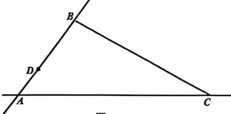
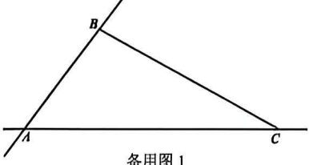
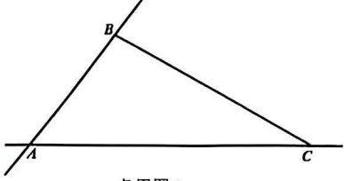

已知：如图，点 $D$ 是直线 $AB$ 上一动点，连接 $CD$，过点 $D$ 作 $DE\parallel BC$ 交直线 $AC$ 于点 $E$.

（1）如图1，当点 $D$ 在线段 $AB$ 上时，

$①$ 依题意，在图1中补全图形：

$②$ 若 $\angle ABC=100^\circ$，$\angle BCD=20^\circ$，则 $\angle ADC=$ ___ 度.

（2）当点 $D$ 在线段 $AB$ 的延长线上时，请写出 $\angle ADC$、$\angle ABC$、$\angle BCD$ 的数量关系，并证明.

（3）当点 $D$ 在直线 $AB$ 上时，请直接写出 $\angle ADC$、$\angle ABC$、$\angle BCD$ 的数量关系，不需证明.

图1 

备用图1 

备用图2 

> [!question]- 点击查看答案与解析
> 【答案】（1）$②$ $120^{\circ}$；（2）$\angle ADC=\angle ABC-\angle BCD$；（3）见解析
> 
> 【考点】平行线的性质，角的计算 → [[【初中数学知识点体系-人教版】#7-2 平行线]]
> 
> 【解析】
> （1）$②$ ∵ $DE\parallel BC$
> 
> ∴ $\angle BDC+\angle BCD=180^{\circ}$（两直线平行，同旁内角互补）
> 
> ∵ $\angle ABC=100^{\circ}$，$\angle BCD=20^{\circ}$
> 
> 在 $\triangle BDC$ 中：$\angle BDC=180^{\circ}-\angle ABC-\angle BCD=180^{\circ}-100^{\circ}-20^{\circ}=60^{\circ}$
> 
> ∴ $\angle ADC=180^{\circ}-\angle BDC=180^{\circ}-60^{\circ}=120^{\circ}$
> 
> （2）当点 $D$ 在线段 $AB$ 的延长线上时：
> 
> ∵ $DE\parallel BC$
> 
> ∴ $\angle BDC=\angle BCD$（两直线平行，内错角相等）
> 
> ∵ $\angle ABC=\angle ADC+\angle BDC$（三角形外角定理）
> 
> ∴ $\angle ADC=\angle ABC-\angle BDC=\angle ABC-\angle BCD$
> 
> （3）当点 $D$ 在直线 $AB$ 上时：
> 
> - 当点 $D$ 在线段 $AB$ 上时：$\angle ADC+\angle BDC=180^{\circ}$，$\angle BDC=180^{\circ}-\angle ABC-\angle BCD$
> - 当点 $D$ 在线段 $AB$ 的延长线上时：$\angle ADC=\angle ABC-\angle BCD$
> - 当点 $D$ 在线段 $BA$ 的延长线上时：$\angle ADC=\angle BCD-\angle ABC$
> 
> 综合：$\angle ADC=|\angle ABC-\angle BCD|$
> 
> 【易错点】需要根据点 $D$ 的位置分类讨论，注意平行线的性质和三角形外角定理。
