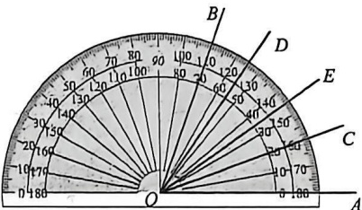

如图，$\angle AOB$ 的角平分线是（）

A. 射线 OB

B. 射线 OE

C. 射线 OD

D. 射线 OC

> [!question]- 点击查看答案与解析
> 【答案】B
> 
> 【考点】角平分线的定义 → [[【初中数学知识点体系-人教版】#6-3 角]]
> 
> 【解析】
> 根据角平分线的定义：从一个角的顶点引出的一条射线，把这个角分成两个相等的角，这条射线叫做这个角的角平分线。
> 
> 观察图形，射线 OE 将 $\angle AOB$ 分成两个相等的角，因此射线 OE 是 $\angle AOB$ 的角平分线。
> 
> 【易错点】角平分线是一条射线，不是线段，要准确识别将角平分的射线。
