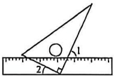

如图，将三角板的直角顶点放在直尺的一边上。若 $\angle 1=65^\circ$，则 $\angle 2$ 的度数为（）

A. $15^\circ$

B. $35^\circ$

C. $25^\circ$

D. $40^\circ$

> [!question]- 点击查看答案与解析
> 【答案】C
> 
> 【考点】平行线的性质，角的计算 → [[【初中数学知识点体系-人教版】#7-2 平行线]]
> 
> 【解析】
> 如图，三角板的直角顶点放在直尺的一边上，$\angle 1=65^\circ$。
> 
> 因为三角板是直角三角形，直角顶点在直尺边上，所以 $\angle 1$ 与 $\angle 2$ 互余，即 $\angle 1+\angle 2=90^\circ$。
> 
> 因此 $\angle 2=90^\circ-65^\circ=25^\circ$。
> 
> 【易错点】要准确识别三角板的直角，利用互余关系求角，注意不是利用平行线性质直接求解。
