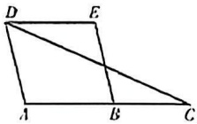

如图：请你添加一个条件 ___ 可以得到 $DE \parallel AB$

> [!question]- 点击查看答案与解析
> 【答案】$\angle A=\angle CDE$（答案不唯一）
> 
> 【考点】平行线的判定 → [[【初中数学知识点体系-人教版】#7-2 平行线]]
> 
> 【解析】
> 要使 $DE \parallel AB$，可以根据平行线的判定定理：
> 
> 方法一：同位角相等，两直线平行，可添加 $\angle A=\angle CDE$；
> 
> 方法二：内错角相等，两直线平行，可添加 $\angle A=\angle AED$；
> 
> 方法三：同旁内角互补，两直线平行，可添加 $\angle A+\angle ADE=180^\circ$。
> 
> 【易错点】平行线的判定有三种方法，需要根据图形选择合适的条件。
