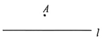
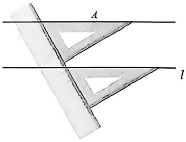

阅读下面材料：在数学课上，老师提出如下问题：

作图：过直线外一点作已知直线的平行线.

已知：直线 $l$ 及其外一点 A.

求作：$l$ 的平行线，使它经过点 A.

小天利用直尺和三角板进行如下操作：

如图所示：

$①$ 用三角板的一条边与已知直线 $l$ 重合：

$②$ 用直尺紧靠三角板一条边：

$③$ 沿着直尺平移三角板，使三角板的一条边通过已知点 $A$；

$④$ 直线重合的斜边通过已知点 $A$；

$⑤$ 沿着这条斜边画一条直线，所画直线与已知直线平行.

老师说："小天的作法正确。"

请回答：小天的作图依据是___ 。

> [!question]- 点击查看答案与解析
> 【答案】同位角相等，两直线平行
> 
> 【考点】平行线的判定 → [[【初中数学知识点体系-人教版】#7-2 平行线]]
> 
> 【解析】
> 小天用直尺和三角板作平行线：
> 
> 操作过程中，保持三角板的一条边与已知直线重合，然后沿着直尺平移；
> 
> 这样保证了平移前后三角板与直尺的夹角不变，即同位角相等；
> 
> 根据平行线的判定定理：同位角相等，两直线平行。
> 
> 【易错点】要理解三角板作平行线的原理，本质是利用了"同位角相等，两直线平行"的判定定理。
