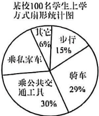

某校有 500 名学生。为了解全校每名学生的上学方式，该校数学兴趣小组在全校随机抽取了 100 名学生进行抽样调查，整理样本数据，得到扇形统计图如右图：

（1）本次调查的个体是 ___ ，样本容量是 ___ ；

（2）扇形统计图中，乘私家车部分对应的圆心角是 ___ 度；

（3）请估计该校 500 名学生中，选择骑车和步行上学的一共有多少人？

> [!question]- 点击查看答案与解析
> 【答案】（1）每名学生的上学方式，$100$；（2）$72$；（3）$150$ 人
> 
> 【考点】统计调查、扇形统计图 → [[【初中数学知识点体系-人教版】#12-2 用统计图描述数据]]
> 
> 【解析】
> （1）本次调查的个体是每名学生的上学方式，样本容量是 $100$。
> 
> （2）乘私家车部分占 $20\%$，对应的圆心角是 $20\%\times360^\circ=72^\circ$。
> 
> （3）骑车占 $20\%$，步行占 $10\%$，共占 $20\%+10\%=30\%$。
> 估计全校 $500$ 名学生中，选择骑车和步行的有 $500\times30\%=150$（人）。
> 
> 【易错点】样本容量不带单位；圆心角 $=$ 百分比 $\times360^\circ$。
