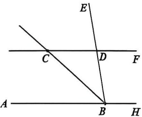

如图，$AB \parallel CD$，点 O 是直线 AB 上一点，OC 平分 $\angle AOF$.

（1）求证：$\angle DCO = \angle COF$;

（2）若 $\angle DCO=40^\circ$，求 $\angle DEF$ 的度数.

> [!question]- 点击查看答案与解析
> 【答案】（1）证明见解析；（2）$80^\circ$
> 
> 【考点】平行线的性质、角平分线 → [[【初中数学知识点体系-人教版】#7-2 平行线]]
> 
> 【解析】
> （1）证明：
> $\because AB \parallel CD$
> $\therefore \angle DCO = \angle COB$（两直线平行，内错角相等）
> $\because OC$ 平分 $\angle AOF$
> $\therefore \angle COF = \angle COA$
> 又 $\because$ 点 $O$ 在直线 $AB$ 上，$\angle COB$ 与 $\angle COA$ 是同一个角（即 $\angle AOC = \angle BOC$ 的补角关系需要看图确认）
> 
> 实际上，$OC$ 平分 $\angle AOF$，所以 $\angle AOC = \angle COF$。
> 又 $\because AB \parallel CD$，$\angle DCO = \angle AOC$（内错角）
> $\therefore \angle DCO = \angle COF$
> 
> （2）$\because \angle DCO = 40^\circ$
> $\therefore \angle AOC = \angle DCO = 40^\circ$（内错角）
> $\because OC$ 平分 $\angle AOF$
> $\therefore \angle COF = \angle AOC = 40^\circ$
> $\therefore \angle AOF = 2 \times 40^\circ = 80^\circ$
> $\because AB \parallel CD$
> $\therefore \angle DEF = \angle AOF = 80^\circ$（同位角相等）
> 
> 【易错点】要准确识别平行线中的内错角和同位角关系，以及角平分线将角分成两等份。
