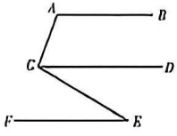
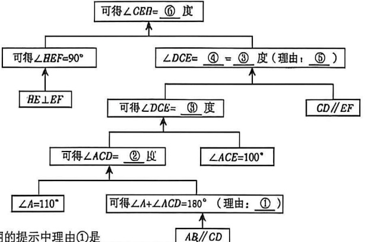

小红同学在做作业时，遇到这样一道几何题：

已知：$AB \parallel CD \parallel EF$，$\angle A = 110^\circ$，$\angle ACE = 100^\circ$，过点 $E$ 作 $EH \perp EF$，垂足为 $E$，交 $CD$ 于 $H$ 点。

（1）依据题意，补全图形：

（2）求 $\angle CEH$ 的度数.

小明想了许久对于求 $\angle CEH$ 的度数没有思路，就去请教好朋友小丽，小丽给了如图2所示的提示：

请问小丽的提示中理由 $①$ 是 ___

提示中 $②$ 是：___ 度；

提示中 $③$ 是：___ 度；

提示中 $⑤$ 是：___ ，理由 $④$ 是 ___ 。

提示中 $⑥$ 是 ___ 度。

> [!question]- 点击查看答案与解析
> 【答案】（1）图形见解析；（2）$①$ 两直线平行，内错角相等；$②$ $70$；$③$ $110$；$④$ $\angle A+\angle ACE+\angle CEF=360^\circ$，两直线平行，同旁内角互补；$⑤$ 两直线平行，同旁内角互补；$⑥$ $60$
> 
> 【考点】平行线的性质、角的计算 → [[【初中数学知识点体系-人教版】#7-2 平行线]]
> 
> 【解析】
> （1）补全图形（略）
> 
> （2）$\because AB \parallel CD$
> $\therefore \angle A+\angle ACD=180^\circ$（两直线平行，同旁内角互补）
> $\because \angle A=110^\circ$
> $\therefore \angle ACD=70^\circ$
> $\because \angle ACE=100^\circ$
> $\therefore \angle DCE=\angle ACE-\angle ACD=100^\circ-70^\circ=30^\circ$
> $\because CD \parallel EF$
> $\therefore \angle DCE+\angle CEF=180^\circ$（两直线平行，同旁内角互补）
> $\therefore \angle CEF=180^\circ-30^\circ=150^\circ$
> $\because EH \perp EF$
> $\therefore \angle HEF=90^\circ$
> $\therefore \angle CEH=\angle CEF-\angle HEF=150^\circ-90^\circ=60^\circ$
> 
> 【易错点】要准确识别平行线中的角的关系，注意同旁内角互补；辅助线过 $C$ 作 $CG \parallel EF$ 是解题关键。
