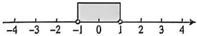
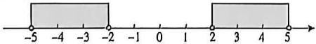

阅读下列材料：

小明在一本课外读物上看到一道有意思的数学题：解不等式 $\left|x\right|<1$，根据绝对值的几何意义，到原点距离小于1的点在数轴上集中在 一1 和 +1 之间，如图：

所以，该不等式的解集为 $-1<x<1$。因此，不等式 $\left|x\right|>1$ 的解集为 $x<-1$ 或 $x>1$。

根据以上方法小明继续探究了不等式 $2<|x|<5$ 的解集，即到原点的距离大于 2 小于 5 的点的集合就集中在这样的区域内，如图：

所以，不等式的解集为 $-5<x<-2$ 或 $2<x<5$。

仿照小明的做法解决下面问题：

（1）不等式 $|x|<5$ 的解集为 ___ 。

（2）不等式 $1<|x|<3$ 的解集是 ___ 。

（3）求不等式 $\left|x-2\right|<2$ 的解集。

> [!question]- 点击查看答案与解析
> 【答案】（1）$-5<x<5$；（2）$-3<x<-1$ 或 $1<x<3$；（3）$0<x<4$
> 
> 【考点】绝对值不等式的解法 → [[【初中数学知识点体系-人教版】#11-2 一元一次不等式]]
> 
> 【解析】
> （1）$|x|<5$ 表示到原点的距离小于 $5$ 的点的集合，解集为 $-5<x<5$。
> 
> （2）$1<|x|<3$ 表示到原点的距离大于 $1$ 小于 $3$ 的点的集合，解集为 $-3<x<-1$ 或 $1<x<3$。
> 
> （3）$|x-2|<2$ 表示到点 $2$ 的距离小于 $2$ 的点的集合。
> 即 $-2<x-2<2$
> $0<x<4$
> 解集为 $0<x<4$。
> 
> 【易错点】$|x-a|<b$ 表示到点 $a$ 的距离小于 $b$ 的点的集合，要准确理解绝对值的几何意义。
