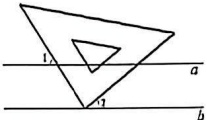

如图，直线 $a \parallel b$，三角板的直角顶点放在直线 $b$ 上，两直角边与直线 $a$ 相交，如果 $\angle 1=60^\circ$，那么 $\angle 2$ 等于（ ）。

A. $30^\circ$

B. $40^\circ$

C. $50^\circ$

D. $60^\circ$

> [!question]- 点击查看答案与解析
> 【答案】A
> 
> 【考点】平行线的性质，角的计算 → [[【初中数学知识点体系-人教版】#7-2 平行线]]
> 
> 【解析】
> 设三角板的两个锐角为 $\angle 1$ 和 $\angle 3$，其中 $\angle 1=60^\circ$。
> 因为三角板是直角三角形，所以 $\angle 1+\angle 3=90^\circ$，$\angle 3=90^\circ-60^\circ=30^\circ$。
> 因为 $a \parallel b$，所以 $\angle 2=\angle 3=30^\circ$（内错角相等）。
> 
> 【易错点】要准确识别平行线中的内错角关系。
