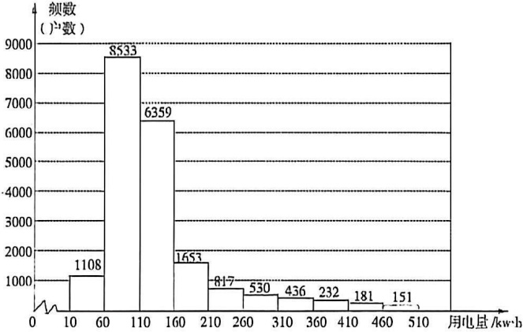

为倡导绿色发展，避免浪费能源，某市准备对居民用电量采用阶梯收费的方法，计划实施三档的阶梯电价：第一档、第二档和第三档的电价分别覆盖全市居民家庭的 80%、15%和 5%。为了合理确定各档之间的界限，相关部门在该市随机调查了 20000 户居民6月份的用电量（单位：$\text{kWh}$），并将收集的样本数据进行排序整理（排序样本），绘制了如下频数分布直方图（每段用电量均含最小值，不含最大值）。

根据以上信息，下面有四个推断：

$①$ 抽样调查6月份的用电量，是因为6月份的用电量在一年12个月的用电量中处于中等偏上水平；

$②$ 在调查的 20000 户居民中，6月份的用电量的最大值与最小值的差小于 500；

$③$ 月用电量小于 $160\,\text{kWh}$ 的该市居民家庭按第一档电价交费，月用电量不小于 $310\,\text{kWh}$ 的该市居民家庭按第三档电价交费。

$④$ 该市居民家庭月用电量的中间水平（50%的用户）为 $110\,\text{kWh}$。

其中合理的是（ ）。

A. $①②③$

B. $①②④$

C. $①③④$

D. $②③④$

> [!question]- 点击查看答案与解析
> 【答案】A
> 
> 【考点】统计图表的分析 → [[【初中数学知识点体系-人教版】#12-2 用统计图描述数据]]
> 
> 【解析】
> - $①$ 抽样调查6月份的用电量，是因为6月份的用电量在一年12个月的用电量中处于中等偏上水平，合理，夏季用电量大
> - $②$ 在调查的 20000 户居民中，6月份用电量的最大值与最小值的差小于 500，从直方图看最大用电量约 500，最小约 0，差约 500，合理
> - $③$ 月用电量小于 $160\,\text{kWh}$ 的按第一档电价交费，月用电量不小于 $310\,\text{kWh}$ 的按第三档电价交费，从直方图看，80% 的用户用电量在 160 以下，15% 在 160-310 之间，5% 在 310 以上，合理
> - $④$ 该市居民家庭月用电量的中间水平（50%的用户）为 $110\,\text{kWh}$，从直方图看，50% 的用户用电量应该在 110 左右，合理
> - 所以 $①②③$ 都合理
> 
> 【易错点】要准确理解频数分布直方图的含义，合理推断数据分布。
