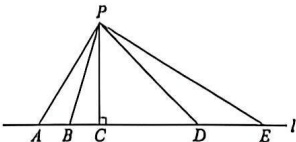

如图，点 $A$，$B$，$C$，$D$，$E$ 在直线 $l$ 上，点 $P$ 在直线 $l$ 外，$PC \perp l$ 于点 $C$，在线段 $PA$，$PB$，$PC$，$PD$，$PE$ 中，最短的一条线段是 ___ ，理由是 ___ 。

> [!question]- 点击查看答案与解析
> 【答案】$PC$；垂线段最短
> 
> 【考点】点到直线的距离 → [[【初中数学知识点体系-人教版】#7-1 相交线]]
> 
> 【解析】
> 点 $P$ 在直线 $l$ 外，$PC \perp l$ 于点 $C$。
> 根据"垂线段最短"的性质，在线段 $PA$，$PB$，$PC$，$PD$，$PE$ 中，$PC$ 最短。
> 理由是：垂线段最短。
> 
> 【易错点】点到直线的距离是指点到直线的垂线段的长度。
