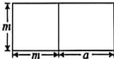

右图中的四边形均为长方形，根据图形，写出一个正确的等式：___ 。

> [!question]- 点击查看答案与解析
> 【答案】$a(m+n)=am+an$（答案不唯一）
> 
> 【考点】乘法分配律，几何面积 → [[【初中数学知识点体系-人教版】#4-2 整式的加法与减法]]
> 
> 【解析】
> 从图形看，大长方形的长为 $m+n$，宽为 $a$。
> 大长方形的面积可以表示为 $a(m+n)$。
> 也可以表示为两个小长方形面积之和：$am+an$。
> 所以 $a(m+n)=am+an$。
> 
> 【易错点】利用几何图形的面积关系验证代数恒等式。
