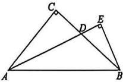

如图，在 Rt$\triangle ABC$ 中，$\angle C=90^\circ$，$AD$ 平分 $\angle CAB$ 交 $BC$ 于点 $D$。$BE \perp AD$ 于点 $E$，若 $\angle CAB=50^\circ$，则 $\angle DBE=$ ___ $^\circ$。

> [!question]- 点击查看答案与解析
> 【答案】$25$
> 
> 【考点】角平分线，互余关系 → [[【初中数学知识点体系-人教版】#6-3 角]]
> 
> 【解析】
> 在 Rt$\triangle ABC$ 中，$\angle C=90^\circ$，$\angle CAB=50^\circ$。
> $AD$ 平分 $\angle CAB$，所以 $\angle CAD=\angle DAB=25^\circ$。
> 在 $\triangle ACD$ 中，$\angle C=90^\circ$，$\angle CAD=25^\circ$，$\angle ADC=90^\circ-25^\circ=65^\circ$。
> 因为 $BE \perp AD$，所以 $\angle BED=90^\circ$。
> 在 $\triangle BDE$ 中，$\angle BDE=\angle ADC=65^\circ$（对顶角），$\angle DBE=90^\circ-65^\circ=25^\circ$。
> 
> 【易错点】要准确利用角平分线和垂直关系，结合三角形内角和求解。
