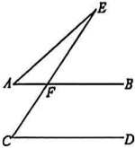

如图，$AB \parallel CD$，$CE$ 交 $AB$ 于 $F$，$\angle C=55^\circ$，$\angle AEC=15^\circ$，则 $\angle A=$ ___ $^\circ$。

> [!question]- 点击查看答案与解析
> 【答案】$110$
> 
> 【考点】平行线的性质，三角形外角 → [[【初中数学知识点体系-人教版】#7-2 平行线]]
> 
> 【解析】
> 因为 $AB \parallel CD$，所以 $\angle AFC=\angle C=55^\circ$（内错角）。
> 在 $\triangle AEF$ 中，$\angle AEC=15^\circ$。
> $\angle A=180^\circ-\angle AEC-\angle AFC=180^\circ-15^\circ-55^\circ=110^\circ$。
> 
> 【易错点】要准确识别平行线中的内错角关系，结合三角形内角和求解。
