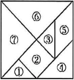
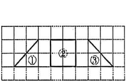
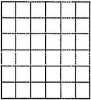
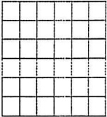

七巧板又称智慧板，是中国民间流传的智力玩具，它由七块板组成（如图1），用这七块板可拼出许多图形（1600 种以上）。例如：三角形、平行四边形以及不规则的多边形，它还可以拼出各种人物、动物、建筑等。请你用七巧板中标号为 $①②③$ 的三块板（如图2）经过平移、旋转拼出下列图形（相邻两块板之间无空隙，无重叠；示意图的顶点画在小方格顶点上）：

图1 

图2 

图3 

图4 

（1）拼成长方形，在图3中画出示意图；

（2）拼成等腰直角三角形，在图4中画出示意图。

> [!question]- 点击查看答案与解析
> 【答案】（1）图形见解析；（2）图形见解析
> 
> 【考点】图形的平移和旋转 → [[【初中数学知识点体系-人教版】#7-4 平移]]
> 
> 【解析】
> 七巧板中标号为 $①②③$ 的三块板分别是：两个小三角形和一个正方形。
> （1）拼成长方形：将两个小三角形分别放在正方形的两侧，可以拼成一个长方形。
> （2）拼成等腰直角三角形：将两个小三角形的斜边拼在一起，再与正方形组合，可以拼成一个等腰直角三角形。
> 
> 【易错点】要注意七巧板各块的形状和大小关系，合理组合。
