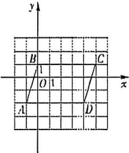

如图，在平面直角坐标系 $xOy$ 中，平行四边形 $ABCD$ 的四个顶点 $A$，$B$，$C$，$D$ 是整点（横、纵坐标都是整数），则四边形 $ABCD$ 的面积是 ___ 。

> [!question]- 点击查看答案与解析
> 【答案】$12$
> 
> 【考点】平行四边形的面积，坐标方法 → [[【初中数学知识点体系-人教版】#9-2 坐标方法的简单应用]]
> 
> 【解析】
> 平行四边形 $ABCD$ 的四个顶点都是整点。
> 从图中可以看出，平行四边形的底为 4，高为 3。
> 面积 $=4 \times 3=12$。
> 
> 【易错点】平行四边形的面积等于底乘以高。
