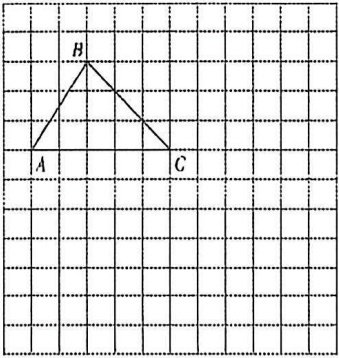

在平面直角坐标系 $xOy$ 中，$\triangle ABC$ 的三个顶点分别是 $A(-2,0)$，$B(0,3)$，$C(3,0)$。

（1）在所给的图中，画出这个平面直角坐标系；

（2）点 $A$ 经过平移后对应点为 $D(3,-3)$，将 $\triangle ABC$ 作同样的平移得到 $\triangle DEF$，画出平移后的 $\triangle DEF$；

（3）在（2）的条件下，点 $M$ 在直线 $CD$ 上，若 $CM=2DM$，直接写出点 $M$ 的坐标。

解：（3）$M$ 点的坐标为 ___ 。

> [!question]- 点击查看答案与解析
> 【答案】（1）图形见解析；（2）图形见解析；（3）$(3,-6)$ 或 $(3,-2)$
> 
> 【考点】坐标与图形，平移 → [[【初中数学知识点体系-人教版】#9-2 坐标方法的简单应用]]
> 
> 【解析】
> （1）根据题意画出平面直角坐标系。
> 
> （2）点 $A(-2,0)$ 平移到 $D(3,-3)$，平移向量为 $(5,-3)$。
> $B(0,3)$ 平移后为 $E(5,0)$。
> $C(3,0)$ 平移后为 $F(8,-3)$。
> 
> （3）设 $M(3,y)$ 在直线 $CD$ 上（$C(3,0)$，$D(3,-3)$，直线 $CD$ 的方程为 $x=3$）。
> $CM=|y|$，$DM=|y+3|$。
> 因为 $CM=2DM$，所以 $|y|=2|y+3|$。
> 
> 情况一：$y=2(y+3)$，$y=-6$，$M(3,-6)$。
> 情况二：$y=-2(y+3)$，$y=-2$，$M(3,-2)$。
> 
> 所以 $M$ 点坐标为 $(3,-6)$ 或 $(3,-2)$。
> 
> 【易错点】要注意分类讨论，绝对值方程要分情况求解。
